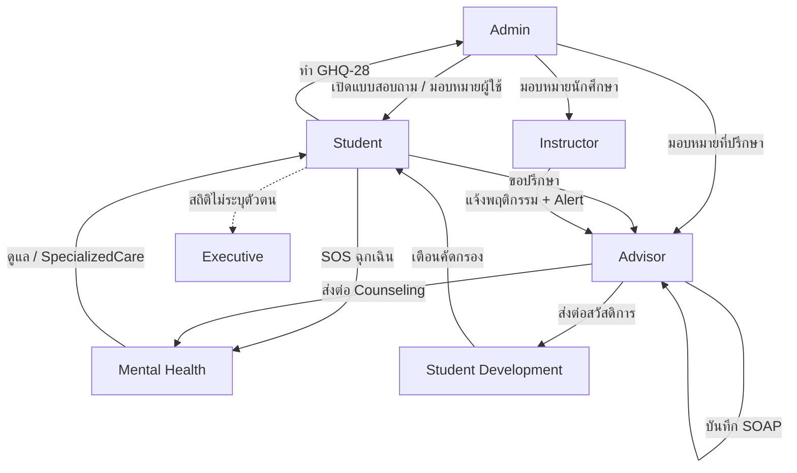
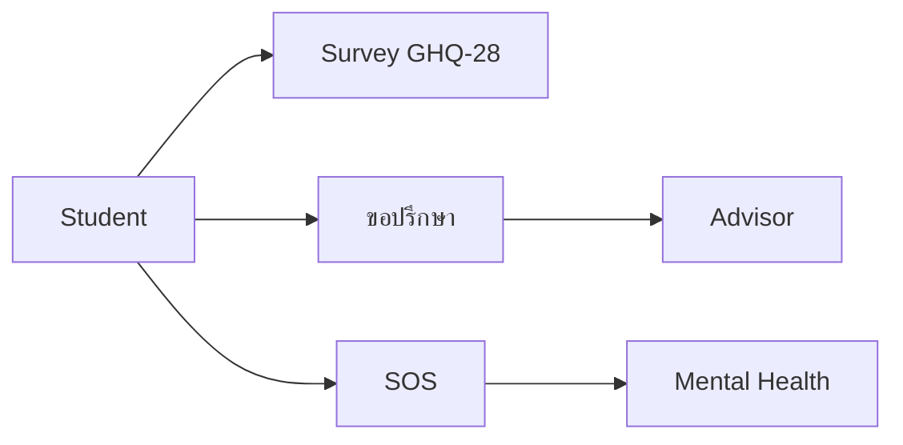
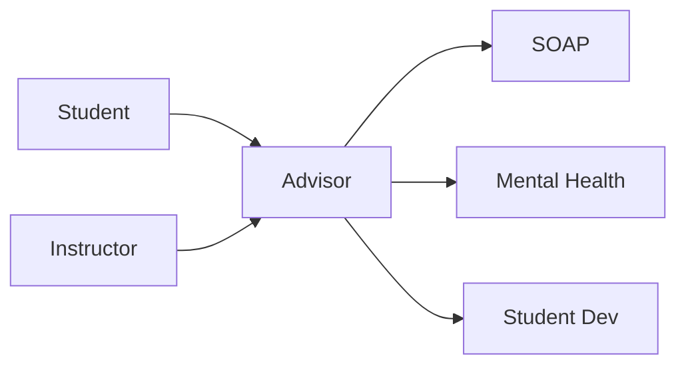
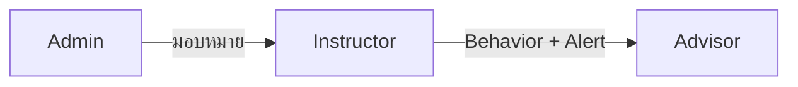
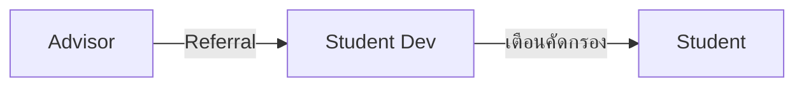
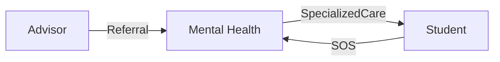
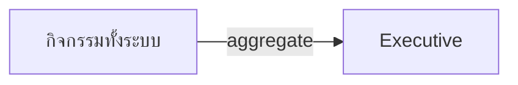
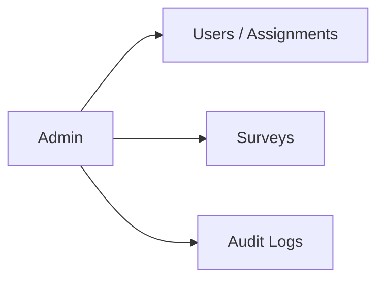
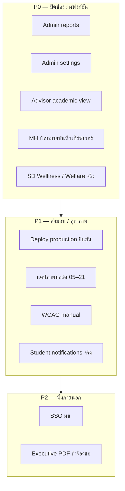

# NUCARE — ความสามารถราย Role (สำหรับไวท์บอร์ด)

**อัปเดต:** 12 กันยายน 2026  
**จำนวน Role:** 7  
**สีบนบอร์ด:** 🟢 เสร็จ · 🟡 บางส่วน/โครง · 🔴 ค้างหรือรอภายนอก

**ใช้บอร์ดยังไง**
1. กลาง = แผนภาพไหลเคส (หมวด 0)  
2. รอบ ๆ = การ์ด 7 Role (หมวด 1–7) แปะสติกเกอร์สถานะ  
3. ขวา = แผนงาน P0/P1/P2 (หมวด 8)

---

## 0) แผนภาพรวม — ใครทำอะไรต่อใคร

---

## 1) STUDENT — นักศึกษา

**URL หลัก:** `/student` · `/student/assessment` · `/student/advisor` · `/student/profile`

| ทำอะไรได้ | สถานะ | หมายเหตุ |
|---|---|---|
| แดชบอร์ดภาพรวมการดูแล | 🟢 เสร็จ | |
| ทำแบบประเมิน GHQ-28 / Survey | 🟢 เสร็จ | คะแนน 4 ระดับ |
| ขอปรึกษาอาจารย์ + ติดตามสถานะ | 🟢 เสร็จ | |
| กด SOS / เคสฉุกเฉิน | 🟢 เสร็จ | ไปทีมสุขภาพจิต |
| ดูโปรไฟล์ + เปลี่ยนรหัสผ่าน | 🟢 เสร็จ | |
| ปฏิทินนัดหมายของตัวเอง | 🟡 บางส่วน | วิดเจ็ตยังว่าง; เห็นเวลาได้ในประวัติคำขอเมื่อ Advisor นัด |
| กระดิ่งแจ้งเตือน | 🟡 โครง | UI อย่างเดียว |
| ลิงก์คลังฮีลใจในแดชบอร์ด | 🟡 โครง | ลิงก์ `#` |
| แก้เบอร์/ผู้ติดต่อฉุกเฉินในแอป | 🟡 บางส่วน | ยังไม่แก้ในแอป (mailto) |
| เข้าสู่ระบบ SSO มข. | 🔴 รอภายนอก | ปุ่มมี ปิดรอ API |

---

## 2) ADVISOR — อาจารย์ที่ปรึกษา

**URL หลัก:** `/advisor`  
**Views:** `(home)` · `advisees` · `consultations` · `referrals` · `academic` · `change-password`

| ทำอะไรได้ | สถานะ | หมายเหตุ |
|---|---|---|
| ดูนักศึกษารับผิดชอบ + ความเสี่ยง | 🟢 เสร็จ | |
| ดูประวัติ (care / referral / behavior / consultation) | 🟢 เสร็จ | |
| บันทึก SOAP CareRecord | 🟢 เสร็จ | |
| ส่งต่อไป Mental Health / Student Dev | 🟢 เสร็จ | |
| รับ/นัด/ปิดคำขอปรึกษา | 🟢 เสร็จ | นัดด้วย prompt (ยังไม่ date-picker) |
| รับ Alert จากระบบ | 🟢 เสร็จ | |
| หน้ารวมปัญหาจากผู้สอน (academic) | 🟡 โครง | Placeholder — ข้อมูลมีในประวัตินักศึกษาแล้ว |

---

## 3) INSTRUCTOR — ผู้สอน

**URL หลัก:** `/instructor`  
**Views:** `(home)` · `courses` · `history` · `change-password`

| ทำอะไรได้ | สถานะ | หมายเหตุ |
|---|---|---|
| เห็นเฉพาะนักศึกษาที่ Admin มอบหมาย | 🟢 เสร็จ | |
| แจ้งพฤติกรรม/สัญญาณเสี่ยง | 🟢 เสร็จ | สร้าง BehaviorRecord + Alert → Advisor |
| ดูประวัติการแจ้ง + สถานะ | 🟢 เสร็จ | |
| กระดิ่งแจ้งเตือน | 🟡 โครง | UI อย่างเดียว |
| ดูคะแนนคัดกรองรายคน | 🔴 ไม่ทำ (โดยออกแบบ) | ส่งสัญญาณเท่านั้น |

---

## 4) STUDENT_DEVELOPMENT — ฝ่ายพัฒนานักศึกษา

**URL หลัก:** `/student-development`  
**Views:** `(home)` · `tracking` · `wellness` · `welfare` · `change-password`

| ทำอะไรได้ | สถานะ | หมายเหตุ |
|---|---|---|
| แดชบอร์ดสถิติคัดกรอง | 🟢 เสร็จ | |
| รายชื่อยังไม่คัดกรอง + ส่งเตือนในแอป | 🟢 เสร็จ | |
| ดูเคสส่งต่อด้านสวัสดิการ | 🟡 บางส่วน | อ่านอย่างเดียว ยังไม่มี CRUD workflow |
| จัดการกิจกรรม Wellness จริง | 🟡 บางส่วน | UI ใช้ข้อมูล insight เป็นการ์ดจำลอง ยังไม่มี API สร้างกิจกรรม |
| เตือนทางอีเมล | 🟡 โครง | ช่องติ๊กมี แต่ปิด hardcode |
| การ์ดแคมเปญบนแดชบอร์ด | 🟡 โครง | ข้อความคงที่ |

---

## 5) MENTAL_HEALTH — ทีมสุขภาพจิต

**URL หลัก:** `/mental-health`  
**Views:** `(home)` · `referrals` · `cases` · `appointments` · `settings` · `change-password`

| ทำอะไรได้ | สถานะ | หมายเหตุ |
|---|---|---|
| รับ/อัปเดตเคสส่งต่อจาก Advisor | 🟢 เสร็จ | |
| จัดการเคสที่รับแล้ว + SOAP SpecializedCare | 🟢 เสร็จ | |
| ดู/ปิดเคสฉุกเฉินจาก SOS | 🟢 เสร็จ | |
| ปฏิทินนัดหมาย | 🟡 บางส่วน | เก็บในหน้าจออย่างเดียว ยังไม่บันทึกเซิร์ฟเวอร์ / นักศึกษาไม่เห็น |
| ตั้งค่าปฏิบัติการ | 🟡 บางส่วน | ช่วยงานหน้าจอ ไม่ใช่ config ระบบ |

---

## 6) EXECUTIVE — ผู้บริหาร

**URL หลัก:** `/executive`  
**Views:** `(home)` · `reports` · `departments` · `trends` · `change-password`

| ทำอะไรได้ | สถานะ | หมายเหตุ |
|---|---|---|
| KPI ภาพรวมแบบไม่ระบุตัวตน | 🟢 เสร็จ | |
| รายงานลึก / heatmap / ชั้นปี / section | 🟢 เสร็จ | |
| แนวโน้ม 6 เดือน | 🟢 เสร็จ | |
| ส่งออก CSV | 🟢 เสร็จ | |
| ส่งออก PDF | 🟡 โครง | ข้อความว่ารอบถัดไป |
| เปิดประวัติรายคน | 🔴 ไม่ทำ (PDPA) | โดยออกแบบ |

---

## 7) ADMIN — ผู้ดูแลระบบ

**URL หลัก:** `/admin` + หน้าจัดการย่อย

| ทำอะไรได้ | สถานะ | หมายเหตุ |
|---|---|---|
| แดชบอร์ดภาพรวม + สุขภาพเซิร์ฟเวอร์ | 🟢 เสร็จ | |
| จัดการนักศึกษา (CRUD, ที่ปรึกษา, ผู้สอน, เลื่อนชั้นปี) | 🟢 เสร็จ | |
| จัดการบุคลากรตาม Role | 🟢 เสร็จ | |
| นำเข้า CSV นักศึกษา / บุคลากร | 🟢 เสร็จ | |
| จัดการแบบสอบถาม + ดูผล + export | 🟢 เสร็จ | |
| Audit Logs + export CSV | 🟢 เสร็จ | |
| เมนูสถิติ/รายงาน | 🟡 โครง | PlaceholderView |
| เมนูตั้งค่าระบบ | 🟡 โครง | PlaceholderView |
| ตั้งค่า SSO | 🔴 รอภายนอก | ยังไม่มีผิวตั้งค่า |

---

## 8) แผนงานแบ่งทีม (แปะขวาบอร์ด)

| ลำดับ | งาน | Role ที่กระทบ | DoD สั้น ๆ |
|---|---|---|---|
| P0 | เติม Admin reports/settings | Admin | ใช้ได้หรือซ่อนเมนู |
| P0 | Advisor academic | Advisor | รายการ Behavior จาก Instructor กรองได้ |
| P0 | MH appointments ลง DB | MH + Student | สร้าง/เห็นนัดได้ทั้งสองฝั่ง |
| P0 | SD wellness/welfare API | Student Dev | CRUD หรือลด scope UI |
| P1 | Deploy + แคปภาพ + WCAG | ทั้งระบบ | URL prod + รูปครบ + เช็คลิสต์ |
| P1 | แจ้งเตือนนักศึกษาจริง | Student | ดึงจาก alerts/API |
| P2 | SSO | ทั้งระบบ | ล็อกอินบัญชี มข. ได้ |

---

## 9) ตารางสรุปเร็ว (แปะมุมบนบอร์ด)

| Role | เสร็จหลัก | ยังค้าง / บางส่วน |
|---|---|---|
| Student | Survey, ปรึกษา, SOS, โปรไฟล์ | แจ้งเตือน, นัดหมาย, SSO |
| Advisor | นักศึกษา, SOAP, ส่งต่อ, คำขอปรึกษา | หน้า academic |
| Instructor | แจ้งพฤติกรรม, ประวัติ | กระดิ่งแจ้งเตือน |
| Student Dev | ติดตามคัดกรอง, เตือนในแอป | Wellness/Welfare จริง, อีเมล |
| Mental Health | รับเคส, SOAP, ฉุกเฉิน | นัดหมาย persist |
| Executive | KPI, heatmap, trends, CSV | PDF |
| Admin | ผู้ใช้, import, survey, audit | reports, settings, SSO |

---

## อ้างอิง

- แผนภาพระบบรวม: `docs/whiteboard-system-map.md`
- รายงานบอร์ด + รายการแคป: `all/รายงานความคืบหน้า-บอร์ด.md` (local)
- โค้ด Role enum: `server/prisma/schema.prisma`
