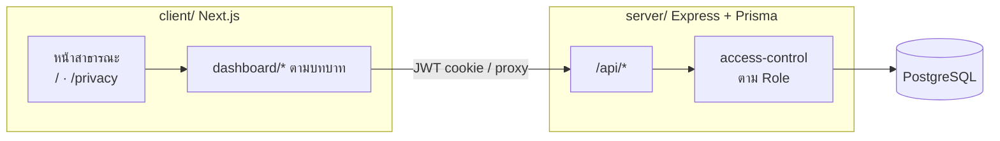
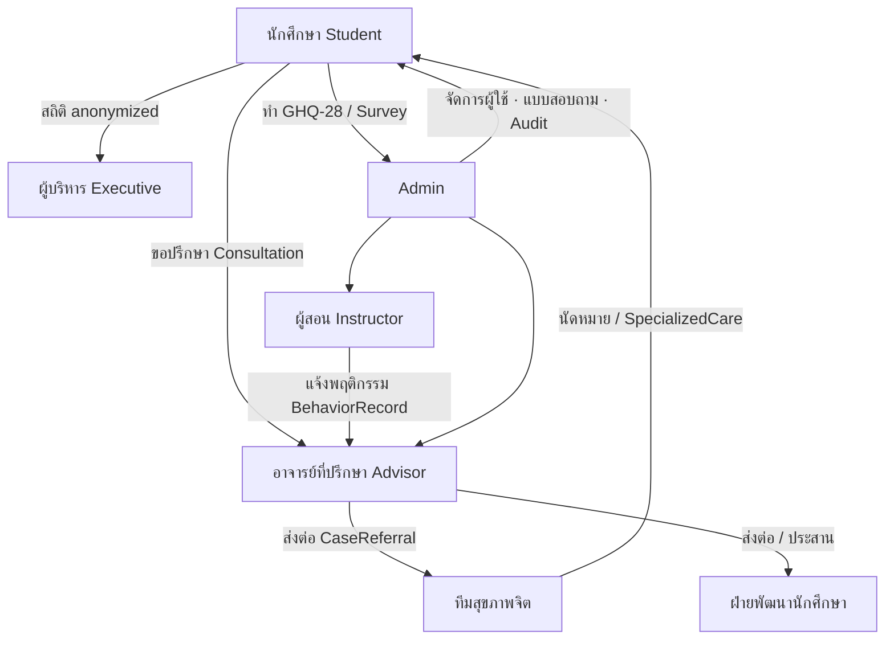
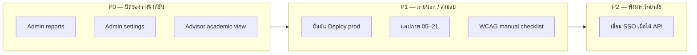
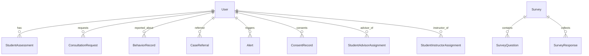

# NUCARE — แผนภาพสถานะระบบ (สำหรับไวท์บอร์ด)

**อัปเดต:** 11 กันยายน 2026  
**ใช้เพื่อ:** แบ่งงาน / เช็คความคืบหน้าทีม / อธิบายบอร์ด  
**สีแนะนำบนบอร์ด:** เขียว = เสร็จ · เหลือง = มีโครง/ยังไม่ครบ · แดง = รอภายนอกหรือยังไม่เริ่ม

---

## 1) สรุปหนึ่งบรรทัด

ระบบดูแลสุขภาวะนักศึกษาครบ **7 บทบาท** แล้ว (Student → Advisor/Instructor → Mental Health / Student Dev → Executive / Admin)  
คัดกรอง GHQ-28, ส่งต่อเคส, PDPA/consent, audit พร้อมใช้  
**ยังค้างหลัก:** SSO มข., Admin รายงาน/ตั้งค่า, Advisor มุมวิชาการ, แคปภาพบอร์ด, ตรวจ WCAG ด้วยมือ, deploy production จริง

---

## 2) แผนภาพสถาปัตยกรรม (วาดกลางบอร์ด)

**โฟลเดอร์อ้างอิง**

| ชั้น | ที่อยู่ |
|---|---|
| หน้าเว็บ | `client/src/app/` |
| API ตามบทบาท | `server/src/routes/` |
| โมเดลข้อมูล | `server/prisma/schema.prisma` |
| Deploy | `docs/vercel-deploy.md`, `docs/docker-production.md` |

---

## 3) แผนภาพบทบาทและการไหลของเคส (วาดซ้ายบอร์ด)

**กฎสิทธิ์ที่ต้องจำ**

- ผู้สอนเห็นเฉพาะนักศึกษาที่ Admin มอบหมาย (`StudentInstructorAssignment`)
- ผู้บริหารดูภาพรวม ไม่เปิดประวัติรายคน
- Consent บันทึกที่ `POST /api/consent` (+ โมเดล `ConsentRecord`)

---

## 4) แผนภาพโมดูล × สถานะ (วาดตารางเช็คบอร์ด)

คัดลอกเป็นตาราง 3 คอลัมน์: **โมดูล | สถานะ | เจ้าของงาน**

| # | โมดูล | สถานะ | รายละเอียดสั้น | เจ้าของ (ว่างให้ทีมเติม) |
|---|---|---|---|---|
| A1 | Landing / ฮีลใจ / ฉุกเฉิน | เสร็จ | `/` | |
| A2 | Login + ลืมรหัส + เปลี่ยนรหัส | เสร็จ | JWT / reset | |
| A3 | Cookie + Privacy PDPA | เสร็จ | UI + API consent | |
| A4 | SSO มหาวิทยาลัย | รอภายนอก | ปุ่มมีแล้ว ปิดรอ API | |
| B1 | Student dashboard | เสร็จ | ประเมิน / ปรึกษา / โปรไฟล์ | |
| B2 | GHQ-28 + คะแนน 4 ระดับ | เสร็จ | มีรายงาน SQA | |
| B3 | Admin จัดการนักศึกษา/บุคลากร + import | เสร็จ | | |
| B4 | Admin แบบสอบถาม | เสร็จ | surveys CRUD | |
| B5 | Admin Audit Logs | เสร็จ | รวม login/security | |
| B6 | Admin รายงานสถิติ | โครงอย่างเดียว | PlaceholderView | |
| B7 | Admin ตั้งค่าระบบ | โครงอย่างเดียว | PlaceholderView | |
| C1 | Advisor dashboard / คำขอ / ส่งต่อ | เสร็จ | | |
| C2 | Advisor มุมวิชาการจากผู้สอน | โครงอย่างเดียว | AcademicPlaceholder | |
| C3 | Instructor แจ้งสัญญาณเสี่ยง | เสร็จ | + scope มอบหมาย | |
| C4 | Mental Health เคส/นัด/ฉุกเฉิน | เสร็จ | | |
| C5 | Student Development ติดตาม/Wellness/Welfare | เสร็จ | | |
| C6 | Executive KPI / reports / trends | เสร็จ | anonymized | |
| D1 | Docker / Vercel checklist | มีแนวทาง | ยังต้องยืนยัน prod จริง | |
| D2 | WCAG AA ตรวจด้วยมือ | ค้าง | lint มีบางส่วนแล้ว | |
| D3 | แคปภาพรายงานบอร์ด | ค้างบางส่วน | มี 01–04 แล้ว ขาด 05–21 | |

---

## 5) ลำดับงานแนะนำให้แบ่งทีม (วาดขวาบอร์ดเป็น swimlane)

| ลำดับ | งาน | ทำไมต้องก่อน | Definition of Done |
|---|---|---|---|
| P0 | เติม Admin reports / settings / Advisor academic | เมนูมีแล้วแต่ยัง placeholder | หน้าใช้งานได้ + API ครบ หรือซ่อนเมนูถ้าเลื่อน scope |
| P1 | Deploy + แคปภาพ + WCAG manual | ใช้ส่งบอร์ด/ตรวจรับ | URL prod + รูปครบใน `all/board-progress-screenshots/` + เช็คลิสต์ผ่าน |
| P2 | SSO | รอ API มข. | ล็อกอินด้วยบัญชีมหาวิทยาลัยได้จริง |

---

## 6) แผนภาพข้อมูลหลัก (ถ้าบอร์ดมีพื้นที่เหลือ)

โมเดลสำคัญอื่น: `EmergencyCase`, `SpecializedCareRecord`, `CareRecord`, `AuditLog`, `RefreshToken`

---

## 7) วิธีใช้บนไวท์บอร์ด (5 นาที)

1. วาด **หมวด 2** ตรงกลาง (Client → API → DB)  
2. วาด **หมวด 3** ด้านซ้าย (ลูกศรเคส)  
3. แปะสติกเกอร์สถานะตาม **หมวด 4** (เขียว/เหลือง/แดง)  
4. แบ่งเจ้าของงานตาม **หมวด 5** แล้วอัปเดตทุก standup  
5. รายละเอียดหน้าจอ/URL ดู `all/รายงานความคืบหน้า-บอร์ด.md`

---

## อ้างอิงในรีโป

- รายงานบอร์ด + รายการแคปภาพ: `all/รายงานความคืบหน้า-บอร์ด.md` (local)
- TOR 5 (WCAG / SEO / PDPA / Audit): `docs/tor-5-compliance.md`
- ทดสอบ GHQ-28: `docs/sqa-ghq28-survey-test-report.md`
- README รันระบบ: `README.md`
